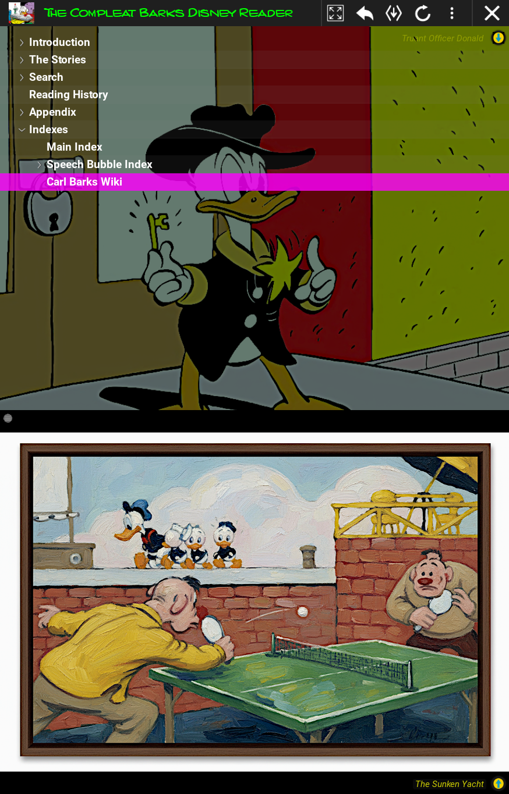
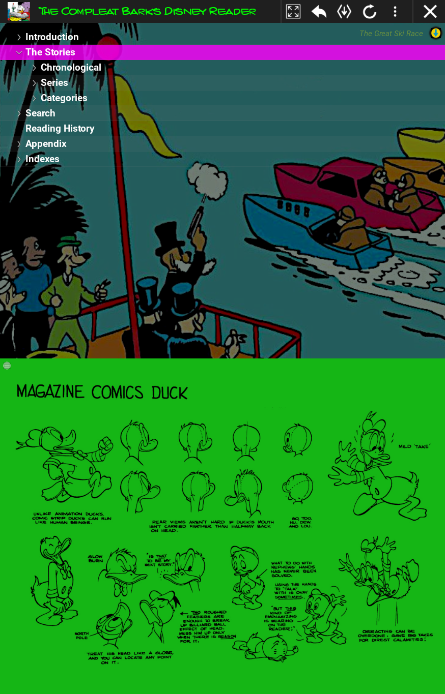
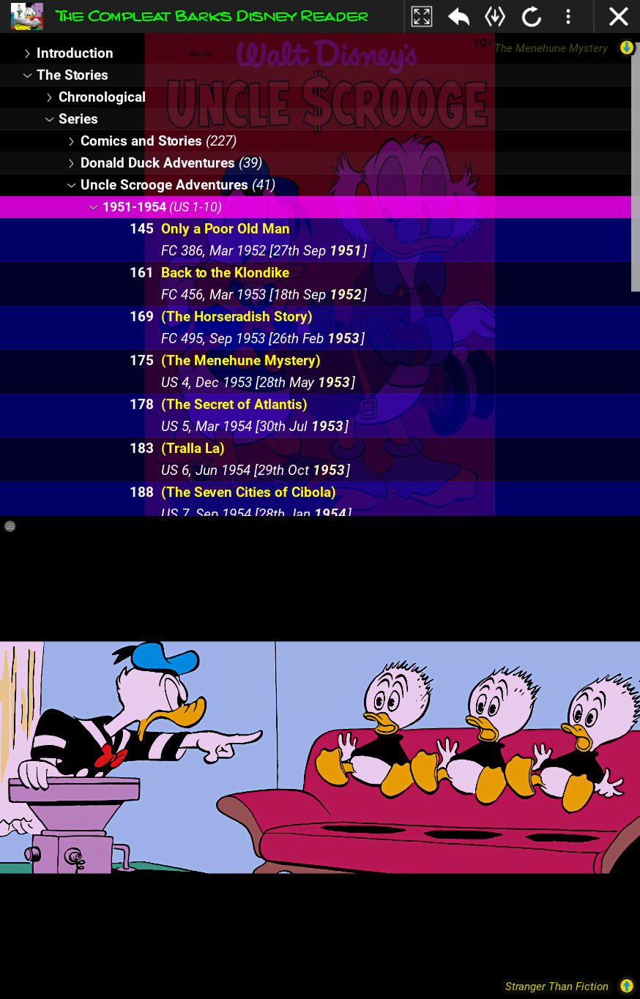
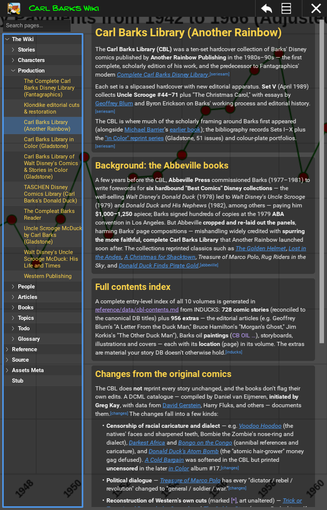
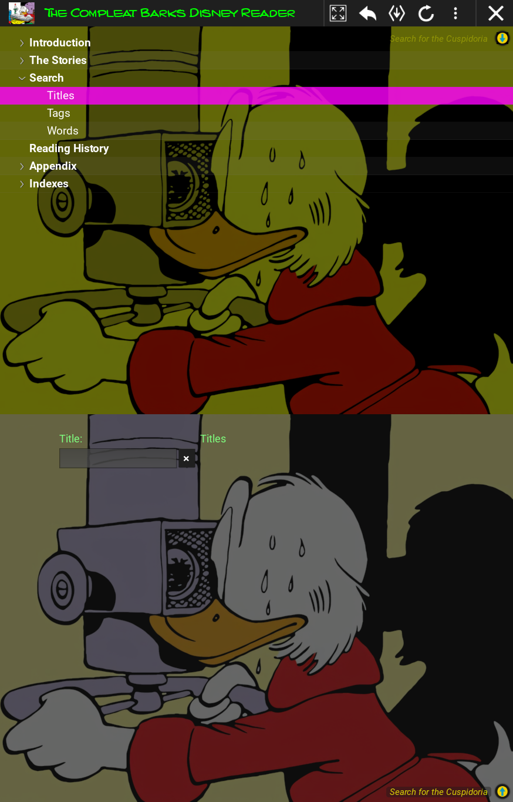
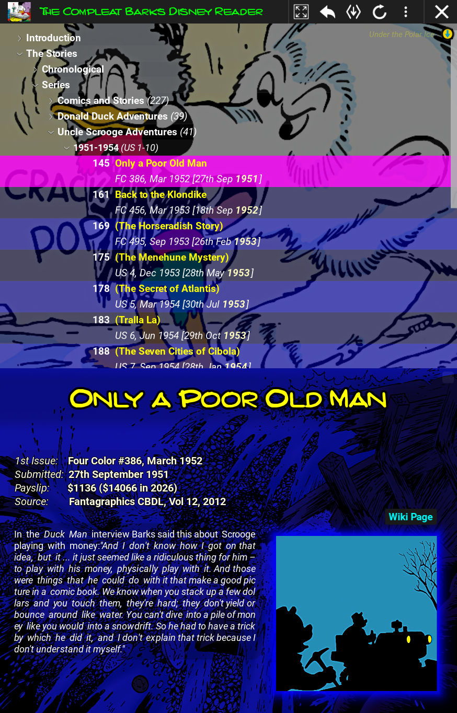

# Design review — July 2026

A UI/visual-design critique of the Barks Reader, produced from a live walkthrough of the
running app (main tree, series/title drill-down, title view, search, Carl Barks Wiki, and the
fullscreen comic reader), cross-checked against the styling code. The app's keyboard UX
constraint applies throughout: everything must work with only Esc/Enter/Left/Right/Up/Down
(4K TV + 6-button remote).

## Status (2026-10-13)

**Phases 0, 1 and 2 are done.** Almost all of it was committed on 2026-07-19, the day the
review was written. The sections from "Verdict" down are the July review as written: their
present tense, screenshots and `file:line` references describe the app *before* the fixes
(where those references are now is in the last table). What is left is under "Still open".

| Item | Status | Commits |
|---|---|---|
| Defect 1, the tint roulette | Done: `RandomColorTint` deleted, fixed neutral scrims (`core/reader_palette.py`, `FixedColorSource` in `core/reader_colors.py`) | `e76fe039`, `001f7600` |
| Defect 2, the programmer palette | Done: every inventoried colour is a `theme()` role; tree and wiki share `accent_selection` | `905775e7`, `e084814b` |
| Defect 3, Escape+Enter quits | Done, one residual (below): Go Back is the starting focus, the quit X asks first (`confirm_quit`, on by default) | `e76fe039`, `41b114de`, `ecd4f5c3`, `058e587f` |
| Wiki background bleed | Done: continuous reading-pane and sidebar scrims; the Contrast toggle darkens the whole pane | `0d23e32f` |
| Title-row emphasis | Done: the title is bold, the year is not | `905775e7` |
| Search screen | Done, then rebuilt again by advanced search (2026-09-29/30, `docs/plans/advanced-search.md`) | `798b8afe`, `e79b5ae5` |
| Letterboxing | Done: fit by aspect ratio (cover only for 0.95 ≤ w/h ≤ 1.60) plus an opt-in `never-crop.txt` | `2c99de05` |
| Chrome glyphs | Partly: every bar's icons are theme-tinted and the three outliers and the hamburger redrawn (sources in `assets/reader-icon-sources/`); the rest are still the Material shapes | `4aaae040` |
| Caption/info contrast | Partly: the caption is `text_title`, the info lines sit on the 0.45 title scrim with outlines; the tree view's caption is still at `label_opacity: 0.3` | `905775e7` |
| Phase 1(a) palette | Done as three user-selectable themes (Masthead, Duckburg, Four Color; `color_theme` setting), not one picked palette | `905775e7`, `001f7600` |
| Phase 1(e) central palette | Done: `core/reader_palette.py`, `ReaderTheme` roles read lazily through `theme()` | `905775e7` |
| okf-reader theming | Done: `ViewerThemeSpec` (`okf_reader/core/theme.py`), the `TopBarSpec` pattern; links deliberately stay blue | `e084814b` |
| Unified focus/selection | Done on the app's screens, one gap (below) | `f74af929` |
| Remaining colour sweep | Mostly done; leftovers below | `99666817`, `fd164ae9`, `ea7d328d`, `a716d422`, `2599f703`, `f3eb2e05` |

Later work in the same spirit: the `text_display` hero-title gold (`295e25e0`); the
`icon_tint`, `scrollbar` and `speech_speaker` roles (`2fe708ab`); the themed peek-toggle eye
(`96e64228`); the Clear History confirm, keyboard-operable end to end (`1483f88b`); Settings
and About on-brand (`a716d422`, `f572cc40`); the story title-page redesign (2026-10-11 to 13).

### Still open

- [ ] **Quit is still Escape, Enter, Enter after a "Stay".** Menu mode restores the last
      button used (`_enter_menu_mode` in `ui/reader_keyboard_nav.py`, from
      `_activate_focused_button`), and the quit popup focuses "Quit" (`41b114de`). So once
      the X has been pressed by keyboard and "Stay" chosen, the next Escape lands on the X
      again. From reading the code; not tried in the app. Resetting `_last_used_btn_idx` to
      the default after a cancelled quit would close it.
- [ ] **The wiki's focus colours are constants, not theme.** `FOCUS_RING_COLOR`
      (`okf_reader/ui/focus_ring.py`) and `LINK_FOCUS_COLOR` (`okf_reader/ui/keynav.py`) are
      a fixed gold close to Masthead's, outside `ViewerThemeSpec`, so Duckburg and Four Color
      wiki pages keep it.
- [ ] **Colour leftovers.** `MessagePopup`'s pure-blue background and red title
      (`ui/reader_popups.kv`); the fun-image options heading in pure yellow
      (`ui/fun_image_view_screen.kv`); the comic reader's goto-page buttons in cyan, teal,
      yellow and orange (`ui/comic_book_reader.py`); the orange "CLICK ME!"
      (`ui/bottom_title_view_screen.kv`). The red tree error label is probably deliberate.
      How each looks on screen is unchecked.
- [ ] **Caption contrast on the tree view** — the caption overlay is at `label_opacity: 0.3`
      on a transparent background (`ui/tree_view_screen.kv`). Visual; not judged.
- [ ] **The other Material glyphs** — tinted but not redrawn. The live PNGs are in the Reader
      Files bundle, not the repo.
- [ ] **Stale "Cyan …" comments** in `ui/bottom_title_view_screen.kv` over labels that are no
      longer cyan.
- Contingency, not a task: a `no-background.txt` ban list for the wiki, if a chart ever beats
  the scrim floor (`0d23e32f` chose the floor).

### Where the review's code references went

| In the review | Now |
|---|---|
| `core/reader_colors.py` `RandomColorTint.get_random_color()` | deleted; `FixedColorSource` |
| `core/view_pipeline.py` `_set_top_view_image_color` | still there, returns the fixed scrim |
| `ui/tree_view_nodes.py:39` (selected colour) | `ui/reader-tree-view.kv`, `theme().accent_selection` |
| `core/reader_consts_and_types.py:9` `ACTION_BAR_TITLE_COLOR` | deleted; `theme().app_title` (`ui/action_bar.py`) |
| `ui/tree_view_nodes.py:155-156` (striping) | `ui/reader-tree-view.kv`, `row_stripe_even/odd` |
| `ui/main_screen.py:126-137`, `ui/reader_keyboard_nav.py:155-163` | `default_focus_idx` in `ui/main_screen.py`; `_enter_menu_mode` |
| `main_screen.kv:131`, `barks_reader_app.py:137-142` | `on_release: root.request_quit()`; `MainScreen.request_quit` |
| `core/reader_formatter.py:164-166` | the year markup, no longer bold, further down the same file |
| `core/image_selector.py:362-364` `_get_random_fit_mode` | deleted; `_get_fit_mode` / `_get_adaptive_fit_mode` |

## Verdict in one line

The app sits on a world-class visual identity — Barks' own art on every screen, his lettering
font for display type, silhouette panels, a chrome-free reader — and then undercuts it with
arbitrary full-screen color washes and programmer-palette accents that don't come from Barks'
world.

## What genuinely works

- **The comic reader is the best screen in the app.** Pure black, zero chrome, art centered,
  controls hidden until Escape. The comic is the hero and nothing competes with it.
- **The Carl Barks lettering font for display titles** ("Only a Poor Old Man" on the title
  view) is a real signature. Yellow with a black outline is authentic four-color cover
  vocabulary.
- **Art-as-wallpaper is the right instinct.** Rotating panels behind the tree, the framed
  "fun image" paintings, the silhouette thumbnails, and the italic caption naming the source
  artwork are details collectors will love.
- **The wiki screen is the most disciplined layout**: dark neutral article panels, gold
  headings, sane line length, readable body text.
- The yellow focus ring on focused toolbar buttons is a good 10-foot-UX primitive.

## The three defects that matter most

### 1. The tint roulette

Each navigation step re-tints the background art with a random hue: the same Donald panel
appears olive, then pure green; the Series list gets a blood-red wash; Search screams
magenta-purple. Consequences: (a) Barks' famously controlled palette — the app's single
greatest asset — is shown false-color; (b) tree-text legibility is a dice roll, because white
text lands on whatever luminance the tint produced.

Mechanism: `core/reader_colors.py` `RandomColorTint.get_random_color()` builds a near-black
base and randomizes 1–2 RGB channels in (200, 255); a new color is rolled on *every*
navigation in `core/view_pipeline.py` (`_set_top_view_image_color` and friends) and applied
as a Kivy `Image.color` multiply.

**Fix:** untinted art under one fixed dark scrim (a neutral grey multiply darkens with no hue
shift), so text legibility is constant everywhere and the art shows true colors.

*The boot screen: olive/red wash over the tree background art.*

*A later visit to the same screen: the art has turned pure green, and the bottom model-sheet
is green too.*

### 2. The programmer palette

- Selection bar is pure RGB magenta — `TREE_VIEW_NODE_SELECTED_COLOR = (1, 0, 1, 0.8)`
  (`ui/tree_view_nodes.py:39`) — a debug color that appears nowhere in Barks' world and
  clashes with the yellow title text.
- App title is pure lime green `(0, 1, 0, 1)` (`ACTION_BAR_TITLE_COLOR`,
  `core/reader_consts_and_types.py:9`), echoed by six repeated green `(0.5, 1, 0.5, 1)`
  labels in `search_screen.kv` and cyan buttons/checkbox labels on the title view.
- Row striping is pure blue `[0,0,0.4,0.4]` / `[0,0,1,0.4]` (`tree_view_nodes.py:155-156`).
- Two selection languages coexist: tree magenta vs the wiki sidebar's blue.

The masthead vocabulary of the actual comics — *Uncle Scrooge* red, cover-yellow, newsprint
cream — is visible in the very cover art the app displays behind these widgets.

**Fix:** a small central palette module with colors extracted from the cover art, applied to
selection, app title, search labels, striping, and focus ring.

*Magenta selection bar, blue striping — and the submitted year gets the strongest emphasis on
the row (bold + bright) while the story title itself doesn't.*

### 3. Escape is one Enter away from quitting the app

On the main screen, Escape enters action-bar "menu mode" with focus defaulting to button
index 0 — which is the quit X (`ui/main_screen.py:126-137`,
`ui/reader_keyboard_nav.py:155-163`). Enter then fires `app.close_app()` with **no
confirmation** (`main_screen.kv:131` → `barks_reader_app.py:137-142`). On a remote, backing
out of a screen and pressing Enter is a natural gesture; here it kills the app.

**Fix:** default menu-mode focus to a harmless button (go-back), and fence the quit button
with a confirmation popup (Enter = quit, Escape = stay), gated behind a settings toggle.
The comic reader's identical pattern is fine as-is — its X only closes the reader.

## Second-tier issues

- **Wiki background bleed** — giant chart text ("Payments from 1942 to 1966…") bleeds
  through behind the toolbar and between article panels.

  

- **Title-row emphasis is muddled** — the submission year gets bold-bright markup
  (`core/reader_formatter.py:164-166`), the strongest treatment on the row, while it's the
  least important fact. Bold belongs on the title.
- **The Titles search screen reads as unfinished** — a ~200 px input floating in space, a
  bare "Title:" label, a stray green "Titles" label, no `hint_text`, no visible results area,
  and the same artwork rendered twice (tinted above the split, untinted below).

  

- **Letterboxing inconsistency** — fun images randomly choose cover vs contain fit
  (`core/image_selector.py:362-364`), so sometimes edge-to-edge, sometimes floating in black
  bars.
- **Generic chrome glyphs** — Material-style toolbar icons sit an inch from the Carl Barks
  lettering and feel off-brand.
- **Caption/info label contrast** — the artwork-source caption and some title-view info
  labels sit at low contrast over busy art.

  

## Remediation plan

- **Phase 0** — this document.
- **Phase 1** — (a) palette swatches extracted from cover art, user picks; (b) fixed scrim
  replaces `RandomColorTint`; (c) Escape/quit safety (default focus + gated confirm popup);
  (d) quick wins: title-row emphasis swap, caption contrast, dead-color cleanup; (e) central
  `core/reader_palette.py` module applied to the defect-2 inventory.
- **Phase 2+** — search screen rework, deterministic letterboxing, okf-reader theme
  parameterization (TopBarSpec pattern) + wiki bleed fix + unified focus/selection language,
  chrome icon set, remaining color sweep.
