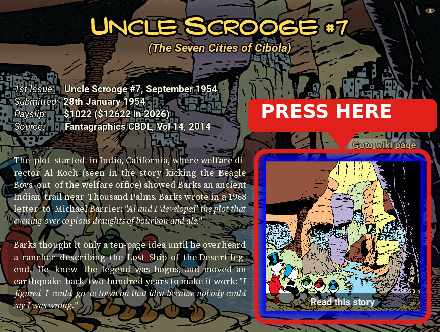
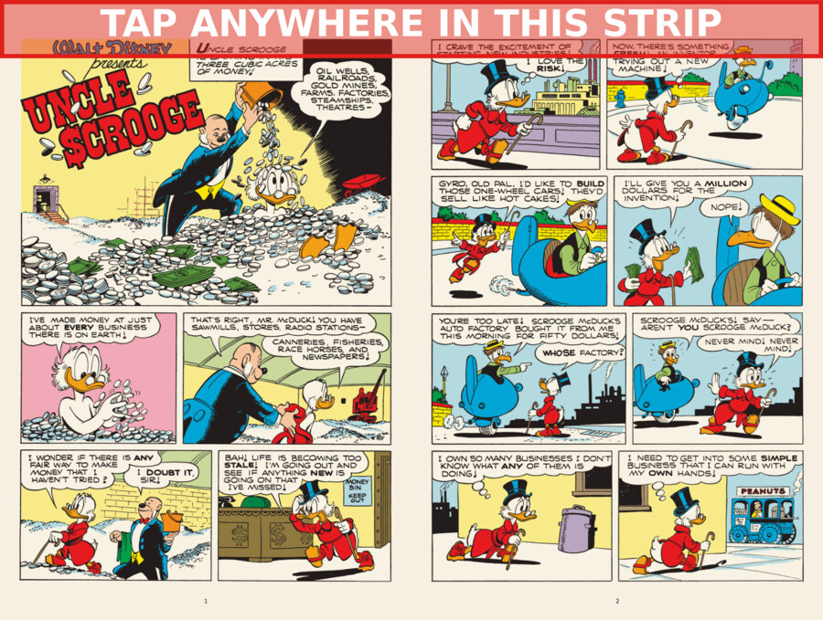
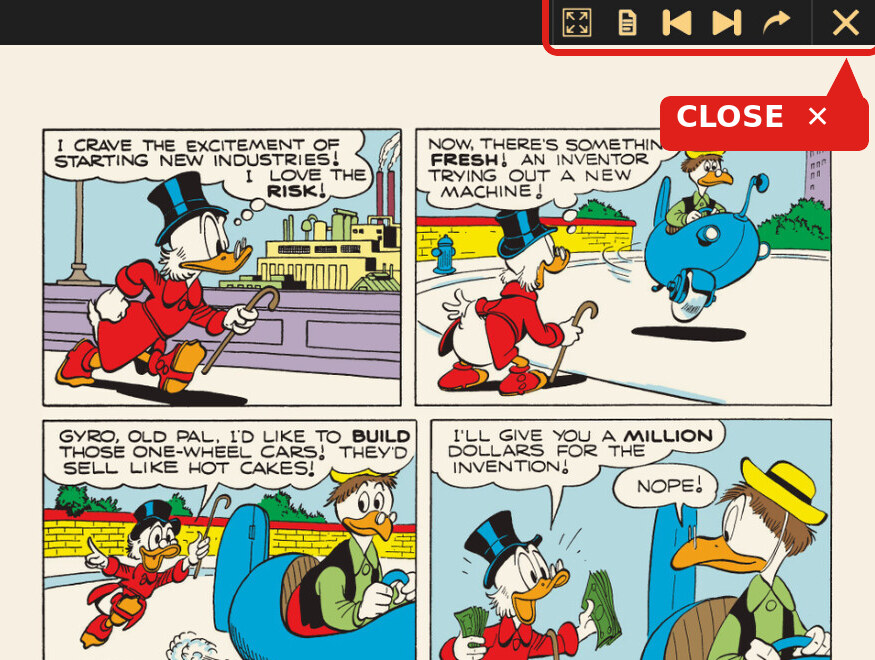
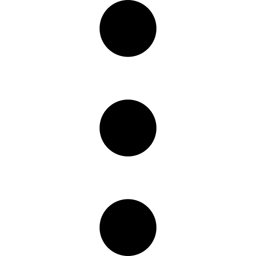

# How to Use the Barks Reader

Most of the Reader explains itself. Two things do not, so they come first.

### Press the story's picture to read it

Choosing a story in the tree does not open the comic: it brings up the story's title view.
**The comic opens when you press the picture at the bottom right of that view**, the
*title portal*.

On a new install the picture says *PRESS TO READ ME!*, and on the next three stories
*Read this story*. After that it says nothing, and it is still the way in.

By keyboard: <kbd>Enter</kbd> on the story, then <kbd>Enter</kbd> again on the picture.

### In fullscreen, tap near the top for the menu bar

A comic read in fullscreen fills the screen, and the reader's menu bar is hidden.
**Tap or click anywhere in the top tenth of the screen to bring the bar down.** Its

button, at the far right, takes you back to the main screen. Tap just below the bar to put it
away again.

By keyboard: <kbd>Up</kbd> or <kbd>Esc</kbd> shows the bar, <kbd>Left</kbd> <kbd>Right</kbd>
move along it, <kbd>Enter</kbd> presses a button, and <kbd>Esc</kbd> hides it.

<figure>

<figcaption>Fullscreen: no bar. Tap the top strip…</figcaption>
</figure>
<figure>

<figcaption>…and the bar comes down, with its buttons.</figcaption>
</figure>

---

## Concept

The Barks Reader gives you full access to all the Barks comics in your Fantagraphics
*"The Complete Carl Barks Disney Library"* digital collection. It knows exactly which
stories appear in which volumes and on which pages, and presents them through several
complementary navigation systems. And if you have a touchscreen 2-in-1 or hybrid 16-inch laptop,
then you can flip and fold it into a portrait screen and get a great Barks reading experience.
On a wide monitor the main screen opens out instead, like a book: the navigation tree on the
left page and the current view on the right.

**No censorship.** Where Fantagraphics made alterations to Barks's original artwork — replacing
or modifying panels for editorial reasons — the Reader includes override image files that
restore the original artwork. These are applied automatically. However, some of the controversial fixes
(like 'Larkies' to 'Harpies') can be turned off individually in Settings if you prefer the
Fantagraphics versions.

---

## Layout

The main screen has two layouts, and the *Layout* setting chooses between them:

- **Single page** — for a portrait screen: the navigation tree above, the current view below.
- **Two-page spread** — for a landscape screen: the tree is the left page, the current view —
  a story's title view, the fun view, an index or a search — is the right page, and the menu
  bar runs across both. Each page of the spread is as wide as the single page would be on the
  same screen, so nothing gets smaller.
- **Match the screen** — the default: picks whichever of the two fits the monitor.

The comic reader follows: on the spread a comic opens two pages at a time, on the single page
one, and the reader's *Double Page* button switches the comic at hand. The sections below
describe the single page: on the spread, what sits *below* the tree sits *beside* it.

### Top Menu Bar

The bar across the top of the main screen contains:

- **App icon** — on the far left, clickable; go to the story associated with icon image.
- 
  — toggles between windowed and fullscreen mode.
- 
  — returns to the previously selected navigation node.
- 
  — collapses all expanded nodes in the navigation tree.
- 
  — randomly refreshes the background and panel images.
- 
  — opens a dropdown containing
    <strong><em>Settings,</em></strong> <strong><em>How To,</em></strong> <strong><em>Update Data,</em></strong>
    and <strong><em>About.</em></strong> <em>Update Data</em> looks for newer data packs placed beside the app
    and offers to install them (or says why there is nothing to install).
- 
  — a power button at the far right, set apart in the window corner; quits the application.

### Navigation Tree (left panel)

The tree on the left is the primary way to find stories. Its top-level sections are:

- **Introduction** — introductory articles for the *Compleat Barks Reader* project, plus
  *By the Numbers*, a one-page statistical portrait of the whole corpus, with a count of
  how many of the stories you have read.
- **The Stories** — all Barks stories, browsable in three ways:
  - *Chronological* — organised by Barks' submission dates.
  - *Series* — grouped by the comic series they appeared in (Comics & Stories, Donald Duck Adventures, 
    Uncle Scrooge Adventures, etc.).
  - *Categories* — thematic groupings.
- **Search** — find stories by *Titles*, by *Tags*, or by *Words* (speech-bubble text). Words and
  tags can be combined, narrowed to an era, and a word search to who says it or to a tag's
  stories: see [Searching](#searching) below.
- **Reading** — five ways to pick something to read:
  - *Continue reading* — the stories you left part-way through, the most recent first. Open
    one and its title view offers the page you stopped on.
  - *Choose for me* — a fresh random handful of stories, re-rolled each time you open the node:
    *Surprise me*, *From not yet read* (only stories with no dot), a decade
    (*From the 1940s/50s/60s*), *From favourites*, or *With Scrooge*, *Gladstone*, *Gyro*,
    *Daisy*, *the Beagle Boys* or *Grandma Duck*.
  - *November in Barks* (named for the current month) — the stories tied to this month in
    any year: those Barks *submitted* in it and those *on sale* in it, by the month on the
    issue's cover. A story submitted on today's date is named at the top of its list.
  - *Playlists* — hand-picked sets of stories, each introduced by a short note.
  - *History* — a journal of the comics you've read, grouped by day. The Reader records this
    automatically (it can be turned off with the *Record Reading History* setting), and the
    history can be cleared from within the view.
- **Appendix** — supplementary articles, a censorship-fixes summary, and reading *Statistics*.
- **Indexes** — the *Main Index* (alphabetic) and the *Speech Bubble Index* (with *Words*, *Names*,
  and *Locations* sub-indexes), and the *Carl Barks Wiki*, whenever the wiki is installed (by default
  the copy that comes with the Reader's files).

A title in parentheses, such as *(The Hypno-Gun)*, is a story Barks left untitled; the name is
one given to it later.

A dot after a story's title says how far you have got with it:

- **A full dot**
   — a story you have read to its last page.
- **A half dot**
   — one you are part-way through (a story you finished before and are reading
  again included).
- **No dot** — one you have not read.

A one-page gag or a cover counts as read once you have opened it. A visit of under a minute counts for nothing: it is taken as a look, not a read. The
dots, *Continue reading*, *From not yet read* and the count on *By the Numbers* all come from the
reading history, so they stop changing while *Record Reading History* is off, and deleting a
story from the *History* view makes it unread again.

Wherever speech bubbles are shown, each bubble names who says it on an italic, coloured line
above the text (*Scrooge:*, *Narrator:* for a narration box). Sound effects and signs have no
speaker line.

### Top Image Area

A large background image sits behind the navigation tree. It is decorative but also interactive:

- A **goto-title button**
  
  (an open book) at the top right navigates to the story associated with that image.
- Click **Refresh** in the menu bar to pick a new random image.

### Bottom Panel

The bottom half below the main tree content (the right page, on the two-page spread) switches
between two modes:

**Title View** — shown when a story is selected in the tree. Displays the story's title,
publication info, and a favorite panel. A story Barks left untitled is headed by the issue it
first appeared in, as long-time readers know it, with its later name in parentheses underneath;
the comic reader's top bar shows the same two lines. Contains:

- A **title portal button** (bottom right) that opens the comic reader directly. On a new
  install it says *PRESS TO READ ME!* until the first comic is opened from it, then carries a
  *Read this story* caption for the next three (the *Say 'Read this story' on the Story
  Picture* setting keeps the caption for good, or turns it off).
- A **"Goto page N:" checkbox** (optional) — appears when the Reader has remembered where you left
  off in this story, or when you reached the story through a tag that marks particular pages; tick
  it to have the portal button reopen the comic at that page instead of the first page. When a tag
  marks several pages the label reads *Goto page N (2 of 5):* and two small arrows beside it (or
  <kbd>Left</kbd> <kbd>Right</kbd> while the row is focused) step through them.
- A **"Goto wiki page" link** (optional) — appears when the story has a page in the Carl Barks
  Wiki; opens that story's page in the Wiki Reader.
- An **override toggle** (optional) — lets you turn off the censorship fix for this specific story.
- A **peek toggle**
  
  (top right of the bottom view, on the single page) — a themed eye that hides the title info to
  reveal just the art behind it. The two-page spread has no eye: there the art is a picture of
  its own, with nothing over it. The eye is open while the info panel is showing and slashed once it is hidden, and it
  stays visible in both states so you can always bring the panel back. The portal button remains
  clickable even when the panel is hidden.

**Fun View** — shown when no specific story is selected. Displays a random comic panel.

- A **category filter button**
  
  at the bottom left of the fun view lets you control which panel
  categories are shown.
- A **goto-title button**
  
  (an open book) at the top right of the fun image navigates to the story
  associated with the currently displayed panel. On the two-page spread, where two panels stack,
  the lower one carries its own.
- **Click left/right** of fun image or use **left/right keys** to step through the panel history.
  On the two-page spread the page is in thirds: the left and right thirds step through the
  history, both panels moving together, and a click in the **middle third** zooms the panel
  under it to fill the page. Click the middle again to bring the pair back; the history does
  not move on a zoom.

---

## Reading the Comics

**Press the story's picture.** Open a comic by clicking its **title portal button**, the picture
at the bottom right of the title view.

### Navigation

- **Click the left half** of the page, or use the **left arrow key** to go back one page.
- **Click the right half** of page, or use the **right arrow key** to go forward one page.

### Top Menu Bar (in the Reader)

**In fullscreen the reader's menu bar is hidden. Click near the top of the screen** to
show it, and click just below it, or press <kbd>Esc</kbd>, to hide it again.

From the keyboard, the **up arrow key** or <kbd>Esc</kbd> shows the bar with a button highlighted:
<kbd>Left</kbd> <kbd>Right</kbd> move between the buttons, <kbd>Enter</kbd> presses one, and <kbd>Esc</kbd> puts the bar
away again. In windowed mode the bar is always shown. It contains:

- 
  — toggles between windowed and fullscreen mode.
- 
  — toggle double page mode for this comic (a comic opens two-up on the two-page spread).
- 
  — jump to the first page.
- 
  — jump to the last page.
- 
  — opens a page selector showing all pages in the comic.
- 
  — at the far right; return to the main screen.

---

<!-- cspell:ignore irline duckin -->

## Searching

The three searches sit under **Search** in the tree. Type in the box at the top left; what matches
is listed under it, and the stories on the right.

### Word search

Typing lists the words the stories use that match what you type: the word itself first, then
words starting with it, then (from three letters) words with it inside (*irline* finds *airline*).
Pick a word — <kbd>Enter</kbd>, or a click — to list the stories that use it, each with the pages it is
on; the speech-bubble button

at the end of a story's row shows its matching bubbles, the words
highlighted.

**Several words.** Each word in the list has a **+** beside it. Picking it adds the word to a row
under the search box, **[ALL] [gold ×] [mine ×]**, and the stories listed are those with every
picked word (**ALL**) or any of them (**ANY** — press the ALL chip to switch). Press a word's
chip, or its **–**, to take it out.

**Typed queries.** Type a query and press <kbd>Enter</kbd> (or pick the *Search for:* row):

| Type | Finds stories with |
|---|---|
| `gold mine` or `gold AND mine` or `gold & mine` | both words, anywhere in the story |
| `gold \| mine` or `gold OR mine` | either word |
| `gold -mine` or `gold NOT mine` | *gold* but not *mine* anywhere in the story |
| `"pirate gold"` | the words next to each other, in one bubble |
| `gold NEAR mine`, `gold NEAR/2 mine` | both in one bubble, at most 5 (or 2) words apart |
| `gol*`, `g?ld` | any word the wildcard matches (at most 200) |
| `(gold \| silver) mine` | brackets group |
| `tag:scrooge`, `tag:"the classics"` | only stories with that tag |
| `year:1950-55`, `vol:7` | only stories submitted in those years, or in that Fantagraphics volume |

A bare word also finds its other forms (*duck* finds *ducks*, *ducked*, *ducking*, *duckin'*); in
quotes it finds only itself. Common words (*the*, *and*, *of*) are left out, with a note. A word
in no story brings spelling suggestions — press one to search again with it in place. Text that
cannot be read as a query (an unclosed bracket, say) is searched as it stands, and a note says why.
The symbols `+`, `|` and a leading `-` mean the same in tag search; the words *AND*, *OR* and
*NOT* work only here, since a tag's name can hold them.
Each story shows how many bubbles matched, e.g. *Lost in the Andes!, 3,5 (4)*.

### Tag search

Typing lists the tags whose names match, each with how many stories it tags; a tag group opens
its members beneath it. Pick a tag to list its stories. Each tag has a **+** too: picked tags sit
under the box, **[ALL] [Gyro Gearloose] [not Christmas]**. Pressing a picked tag steps it from
included, to *not* (its stories left out), to taken out. Tags can be typed as well —
`scrooge + gyro -christmas stories` (use `+` or `,` for ALL, `|` for ANY, not both), with
`year:1950-55` or `vol:7` to keep only the stories of those years or that volume — and <kbd>Enter</kbd>
puts them in place of the tags picked (a range shows as a chip of its own: *years 1950-55*).

### Narrowing the results

- **Era** — a row of year ranges above the results (*All years*, *1942-46*, …, *1962-71*) lists only
  stories submitted in that range. It holds for tag and word search alike.
- **Speaker** — in word search, the *Donald*, *Scrooge*, *Narrator*, … row keeps only the bubbles
  that character says, for every word of a query.
- **Only in** — in word search, while tag search has tags picked (or one tag listed),
  **[Everywhere] [Only in: Gyro Gearloose]** limits the word search to those tags' stories.

The **×** beside the search box clears it, the picked words or tags, and the era.

**By keyboard:** <kbd>Down</kbd> from the box goes to the picked row (if any) and on to the list, and
<kbd>Right</kbd> at the end of the text to the **×**; <kbd>Right</kbd> from a word or tag moves to its **+**, and
again to the rows above the results; <kbd>Down</kbd> <kbd>Up</kbd> move between those rows and the results.
<kbd>Enter</kbd> picks, and on a filter row stays put so you can try another.

---

## Keyboard Navigation

You can navigate everything using a mouse, or if you have a touchscreen, using touch. But you can
also navigate almost everything using the keyboard (some small esoteric buttons are excluded).
Keyboard navigation is great if you're on a big screen TV and using a TV remote.
Keyboard navigation includes:
 
- <kbd>Left</kbd> <kbd>Right</kbd> **arrow keys** — things like turning pages or moving focus to the left or right.
- <kbd>Up</kbd> <kbd>Down</kbd> **arrow keys** — things like scrolling lists or moving focus up or down.
- <kbd>Enter</kbd> **key** — activates the highlighted item. In the navigation tree, Enter opens or closes a
  highlighted branch in place; on a highlighted **story** it moves focus down into the bottom title
  panel (onto the title portal), and a second Enter there opens the comic reader.
- <kbd>Esc</kbd> **key** — moving to a previous focus.

On the bottom title panel, press <kbd>Right</kbd> to move focus into the panel; <kbd>Up</kbd> <kbd>Down</kbd> then
cycle through its widgets — the title portal, the *Goto page* and censorship-fixes
checkboxes, the *Goto wiki page* link, and the peek eye — with <kbd>Enter</kbd> activating the
focused one and <kbd>Esc</kbd> returning to the tree.

In the **comic reader**, <kbd>Left</kbd> <kbd>Right</kbd> turn the pages, and <kbd>Up</kbd> or <kbd>Esc</kbd> lift focus to the
top menu bar, where <kbd>Left</kbd> <kbd>Right</kbd> move between its buttons, <kbd>Enter</kbd> presses one and <kbd>Esc</kbd>
returns to the page.

In the **Wiki Reader** (opened by the *Goto wiki page* link or from the *Carl Barks Wiki* index),
<kbd>Up</kbd> <kbd>Down</kbd> read the page and step through its links while <kbd>Left</kbd> <kbd>Right</kbd> move between the
contents tree and the page. <kbd>Esc</kbd> lifts focus to the reader's top bar, where <kbd>Left</kbd> <kbd>Right</kbd>
move between its buttons and <kbd>Enter</kbd> on **Back** returns to the previous page (and at the first
page, leaves the reader). Opening a story's wiki page lands focus straight in the reading pane.
The **search box** above the contents tree (<kbd>Up</kbd> off the tree's top reaches it) finds pages by
their titles, headings and text, title matches first; a page found by its text shows the words
round the match. Put words in double quotes to find them as a phrase: `"glen brown"`.

---

## Settings

Open *Settings* from the **⋮** menu on the top action bar. Close it with <kbd>Escape</kbd> or the
**✕** in the top-right corner. Settings are grouped into sections — *Folders*, *Reading*,
*Appearance*, *Startup*, *Window*, *Controls*, *Controversial Censorship Fixes*, and
*Advanced* — with the power-user options gathered under *Advanced* at the bottom. Key options
are:

| Setting                                       | What it does                                                   |
|-----------------------------------------------|----------------------------------------------------------------|
| *Fantagraphics Directory*                     | Path to the folder containing your Fantagraphics ZIP files     |
| *Color Theme*                                 | Picks the palette for accents, selection bar, and labels (requires restart) |
| *Layout*                                      | *Single page* (the tree above the view, comics a page at a time), *Two-page spread* (the tree beside it, comics two pages at a time), or *Match the screen*, which picks by the monitor's shape |
| *Go to Last Selection on App Start*           | Resumes where you left off when the app starts                 |
| *Record Reading History*                      | Logs every comic you read to the *History* view under *Reading*; the read marks come from it |
| *Confirm Before Quitting*                     | Asks for confirmation when the app close button is pressed     |
| *Go Straight to Fullscreen on App Start*      | Launches the app in fullscreen                                 |
| *Go Straight to Fullscreen for Comic Reading* | Auto-fullscreen when opening a comic                           |
| *Say 'Read this story' on the Story Picture*  | Captions the Title View's picture, which opens the comic: *For the first few stories*, *Always* or *Never* |
| *Decode Pages Whole*                          | Decodes every page whole for the sharpest page; comics open more slowly |
| *Show Title Info in Top View*                 | Toggles story title display above the tree                     |
| *Show Title Info in Bottom View*              | Toggles story title display in the bottom panel                |
| *Alternate Escape Key*                        | Extra key that behaves like Escape, for remotes without one    |
| *Use Virtual Keyboard*                        | Always shows an on-screen keyboard when tapping search fields, even with a physical keyboard connected                    |
| *First Use of Reader*                         | Reset this to re-run the first-launch setup (requires restart) |
| *Log Level*                                   | Controls how much is written to the log file                   |
| *Controversial Censorship Fixes*              | Individual toggles for some censorship fixes                   |

The *Advanced* section at the bottom holds the image-source, prebuilt-comics, and Carl Barks
Wiki folder settings, along with *Log Level* and *First Use of Reader*. Options that only take
effect after a relaunch are marked *(Restart required.)*.

Settings are saved to `"barks-reader.ini"` and `"barks-reader.json"` in the app's config directory.

---

## Logging

Log files are written to the `"kivy/logs"` subfolder of the app's config directory (the main one
is `barks-reader.log`). The level of detail
is controlled by the **Log level** setting (TRACE / DEBUG / INFO / WARNING / ERROR / CRITICAL).
For normal use, INFO is appropriate. If you are reporting a problem, set it to DEBUG before
reproducing the issue, then include the log file with your report.
